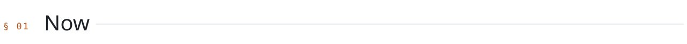
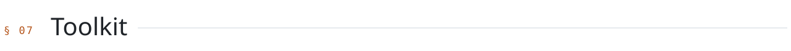

<picture>
  <source media="(prefers-color-scheme: dark)" srcset="assets/header-dark.svg">
  
</picture>

<br>

I like understanding systems all the way down: CPUs from the instruction set up, renderers from raw pixel writes, orbits from the equations of motion. Most of what I build sits where software meets physics and hardware.

<picture>
  <source media="(prefers-color-scheme: dark)" srcset="assets/s01-now-dark.svg">
  
</picture>

- **Studying** Computer Science and Data Science across two universities
- **Learning** kinematics properly before going back to my flight dynamics testbed
- **Building** privacy-preserving applications with Midnight and Compact
- **Exploring** machine learning, embedded systems and AI agents

<picture>
  <source media="(prefers-color-scheme: dark)" srcset="assets/s02-feed-dark.svg">
  
</picture>

<!--LIVE:START-->
```text
┌─ LIVE FEED ───────────────────────────────────────────────┐
  last commit   aayushpx: chore: update live feed (1d ago)
  streak        5 days                                    
  commits       130 this month                            
  active repos  3 in last 30 days                         
  recent work   Python                                    
  as of         2026-11-17 15:36 UTC                      
└────────────────────────────────────────────────────────────┘
```
<!--LIVE:END-->

<picture>
  <source media="(prefers-color-scheme: dark)" srcset="assets/s03-flagship-dark.svg">
  
</picture>

### [Project Aphelion](https://github.com/aayushpx/project-aphelion)

A hardware-in-the-loop flight dynamics testbed for simulating and validating spacecraft motion. An ESP32 acts as a lightweight flight computer streaming live sensor telemetry, while Python handles trajectory propagation, state estimation and mission-side analysis.

> **Status:** paused while I study kinematics properly. Next up when I return: a 3DOF propagator with RK4 integration.

`Embedded C++` `ESP-IDF v5.2` `Python` `NumPy` `ESP32-WROOM`

<picture>
  <source media="(prefers-color-scheme: dark)" srcset="assets/s04-hackathons-dark.svg">
  
</picture>

| Result | Project | Event |
|:--|:--|:--|
| **3rd** | [SPHERExPLORER](https://github.com/CelestiAI-Org/spherex) | NASA Space Apps NZ 2026 |
| **2nd** | [Exoplanet Explorer](https://github.com/CelestiAI-Org/nasa-hackathon-2025) | NASA Space Apps NZ 2025 |
| | [OrbitGuard](https://github.com/CelestiAI-Org/Orbitguard) | ActInSpace NZ 2026 |
| | [Midnight HR Verification](https://github.com/CelestiAI-Org/midnight-hackathon) | Midnight Hackathon 2026 |

**SPHERExPLORER** · planetarium-style sky explorer for NASA's SPHEREx mission. Enter sky coordinates and it pulls SPHEREx survey data from IRSA into an interactive, draggable view of the sky.
<br><sub>Project lead and remote technical lead · Python backend, SPHEREx/IRSA data retrieval and API · `Python` `JavaScript` `Three.js`</sub>

**Exoplanet Explorer** · ML pipeline turning telescope data into 3D habitability visualisations.
<br><sub>Team lead · ML pipeline, Random Forest modelling, habitability scoring · `Python` `scikit-learn` `Flask` `Three.js` `Docker`</sub>

**OrbitGuard** · satellite collision-avoidance decision support. A skip-connection LSTM models how collision risk evolves over time, built in 24 hours.
<br><sub>Team lead · product direction, system design, pitch · `Python` `PyTorch` `TypeScript`</sub>

**Midnight HR Verification** · checks whether a candidate's salary fits an approved budget without ever revealing the salary.
<br><sub>Team lead · system design, privacy architecture, integration · `Midnight` `Compact` `Python` `TypeScript` `Streamlit`</sub>

<picture>
  <source media="(prefers-color-scheme: dark)" srcset="assets/s05-scratch-dark.svg">
  
</picture>

| Project | What it does | Stack |
|:--|:--|:--|
| [16-bit CPU Simulator](https://github.com/aayushpx/16bit-cpu-simulator) | Custom ISA with a full fetch-decode-execute cycle, registers and memory | C++ |
| [C++ Software Rasterizer](https://github.com/aayushpx/cpp-rasterizer) | 2D renderer from raw pixel writes. No graphics API, just math and memory | C++ |
| [Connected Component Detector](https://github.com/aayushpx/connected-component-detector) | DFS flood-fill over raw PPM images to detect and classify regions. No libraries | C++ |
| [Discrete Math Notes and Proofs](https://github.com/aayushpx/mathematical-proofs-and-discrete-structures) | LaTeX system formalising logic, algebra, coding theory and discrete structures | LaTeX |

<picture>
  <source media="(prefers-color-scheme: dark)" srcset="assets/s06-tools-dark.svg">
  
</picture>

| Project | What it does | Stack |
|:--|:--|:--|
| [statsforensics](https://github.com/aayushpx/statistical-analysis-toolkit) | R package for EDA, hypothesis testing, regression modelling and diagnostics | R |
| [Binary / Decimal Converter](https://github.com/aayushpx/binary-decimal-converter) | CLI base conversion with input validation and error handling | C++ |
| [MUITSA Website](https://aayushpx.github.io/muitsa-site/) | Student association site with modular architecture and GitHub Actions deploys | HTML/CSS/JS |

<picture>
  <source media="(prefers-color-scheme: dark)" srcset="assets/s07-toolkit-dark.svg">
  
</picture>

**Languages** &nbsp; C++ · Python · TypeScript · JavaScript · R · Haskell · LaTeX
<br>**ML & data** &nbsp; PyTorch · scikit-learn · Pandas · NumPy
<br>**Web & viz** &nbsp; Three.js · Flask · Streamlit
<br>**Embedded & tools** &nbsp; ESP32 · ESP-IDF · Git · Docker · Linux

<br>

<picture>
  <source media="(prefers-color-scheme: dark)" srcset="assets/footer-dark.svg">
  
</picture>
