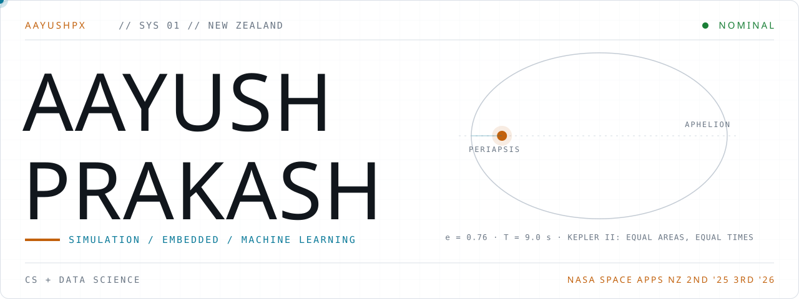
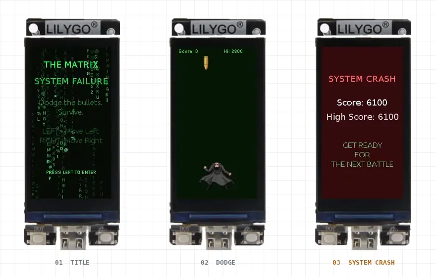
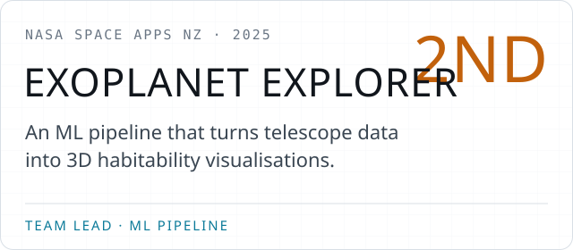
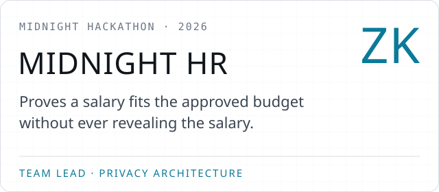

<picture><source media="(prefers-color-scheme: dark)" srcset="assets/header-dark.svg"></picture>

I build things where software meets physics and hardware: microcontrollers, orbital mechanics and machine learning, mostly in C, C++ and Python. Studying Computer Science and Data Science in New Zealand.

<picture><source media="(prefers-color-scheme: dark)" srcset="assets/s1-launcher-dark.svg"></picture>


### [Launcher](https://github.com/aayushpx/Launcher)

A mission-control unit for the LilyGO T-Display S3. A state machine takes it from **SAFE → ARMED → COUNTDOWN → IN FLIGHT → LANDED**, with an abort path. An MPU6050 IMU feeds live acceleration and gyro data over I²C, telemetry streams out over Wi-Fi and MQTT, and every event lands in a ring-buffer mission log. Four screens, driven by a rotary encoder, all written in C on ESP-IDF.

`ESP-IDF` `C` `MPU6050` `I²C` `MQTT` `Wi-Fi` `PWM`

<picture><source media="(prefers-color-scheme: dark)" srcset="assets/s2-neo-dark.svg"></picture>

<picture><source media="(prefers-color-scheme: dark)" srcset="assets/neo-dark.webp"></picture>

### [Neo](https://github.com/aayushpx/neo)

A Matrix dodge game for the T-Display S3. You're Neo, the bullets keep getting faster, and one hit is a **SYSTEM CRASH**. Procedural Matrix rain runs across 40 independent columns on the title screen, difficulty ramps bullet speed (120 → 600 px/s) and spawn rate together, and the high score is saved to flash, so it survives power-off. Custom sprites and two-button controls, written in C on ESP-IDF.

`ESP-IDF` `C` `Game loop` `NVS`

<picture><source media="(prefers-color-scheme: dark)" srcset="assets/s3-hackathons-dark.svg"></picture>

<a href="https://github.com/CelestiAI-Org/spherex"></a>
<a href="https://github.com/CelestiAI-Org/nasa-hackathon-2025"><picture><source media="(prefers-color-scheme: dark)" srcset="assets/hk-exoplanet-dark.svg"></picture></a>
<a href="https://github.com/CelestiAI-Org/Orbitguard"><picture><source media="(prefers-color-scheme: dark)" srcset="assets/hk-orbitguard-dark.svg"></picture></a>
<a href="https://github.com/CelestiAI-Org/midnight-hackathon"><picture><source media="(prefers-color-scheme: dark)" srcset="assets/hk-midnight-dark.svg"></picture></a>
<a href="https://github.com/aayushpx/forge"><picture><source media="(prefers-color-scheme: dark)" srcset="assets/hk-mlh-card-dark.svg"></picture></a>

<sub>Hack Week builds: [FORGE](https://github.com/aayushpx/forge) · [TermGen](https://github.com/aayushpx/termgen) · [OrbitOps](https://github.com/aayushpx/orbitops) · [RepoLens](https://github.com/aayushpx/repolens) · [agent-memory](https://github.com/aayushpx/agent-memory) · [Commit Sage](https://github.com/aayushpx/commit-sage)</sub>

<picture><source media="(prefers-color-scheme: dark)" srcset="assets/s4-bench-dark.svg"></picture>

| Project | What it is | Stack |
|:--|:--|:--|
| [Project Aphelion](https://github.com/aayushpx/project-aphelion) | Hardware-in-the-loop flight dynamics testbed: an ESP32 flight computer streams telemetry while Python propagates the trajectory. **Paused** while I study kinematics properly | C++ · Python |
| [16-bit CPU Simulator](https://github.com/aayushpx/16bit-cpu-simulator) | Custom ISA with a full fetch-decode-execute cycle, registers and memory | C++ |
| [Software Rasterizer](https://github.com/aayushpx/cpp-rasterizer) | A 2D renderer from raw pixel writes. No graphics API, just maths and memory | C++ |
| [Connected Component Detector](https://github.com/aayushpx/connected-component-detector) | DFS flood-fill over raw PPM images to find and classify regions. No libraries | C++ |
| [statsforensics](https://github.com/aayushpx/statistical-analysis-toolkit) | R package for EDA, hypothesis testing, regression and diagnostics | R |

<picture><source media="(prefers-color-scheme: dark)" srcset="assets/s5-telemetry-dark.svg"></picture>

<!--LIVE:START-->
```text
┌─ LIVE FEED ─────────────────────────────────────────────────────────────────────────────────┐
  last commit   CelestiAI-Org/spherex: keepalive: ping only the frontend /health,… (2d ago)
  streak        6 days                                                                     
  commits       156 this month                                                             
  active repos  2 in last 30 days                                                          
  recent work   JavaScript                                                                 
  as of         2026-11-18 11:21 UTC                                                       
└─────────────────────────────────────────────────────────────────────────────────────────────┘
```
<!--LIVE:END-->

<picture><source media="(prefers-color-scheme: dark)" srcset="assets/s6-toolkit-dark.svg"></picture>

**Languages** &nbsp; C · C++ · Python · TypeScript · JavaScript · R · Haskell · Rust · LaTeX
<br>**Embedded** &nbsp; ESP32 / ESP-IDF · I²C · MQTT · FreeRTOS · PlatformIO
<br>**ML & data** &nbsp; PyTorch · scikit-learn · Pandas · NumPy
<br>**Web & viz** &nbsp; Three.js · Flask · Streamlit
<br>**Tools** &nbsp; Git · Docker · Linux · Neovim
