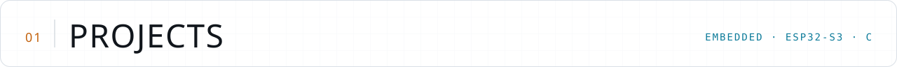
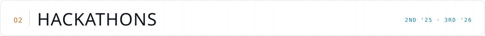
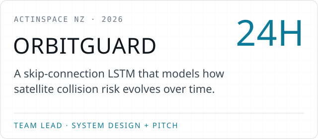
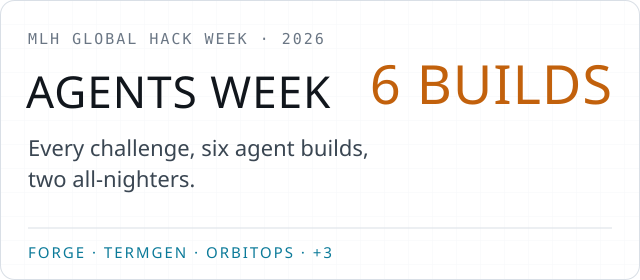

<picture><source media="(prefers-color-scheme: dark)" srcset="assets/header-dark.svg"></picture>

Most of my projects start with *"how hard could it be?"* and end with a breadboard covered in jumper wires.

<picture><source media="(prefers-color-scheme: dark)" srcset="assets/s1-projects-dark.svg"></picture>

<a href="https://github.com/aayushpx/Launcher"></a>
<a href="https://github.com/aayushpx/neo"></a>

<picture><source media="(prefers-color-scheme: dark)" srcset="assets/s2-hackathons-dark.svg"></picture>

<a href="https://github.com/CelestiAI-Org/spherex"></a>
<a href="https://github.com/CelestiAI-Org/nasa-hackathon-2025"><picture><source media="(prefers-color-scheme: dark)" srcset="assets/hk-exoplanet-dark.svg"></picture></a>
<a href="https://github.com/CelestiAI-Org/Orbitguard"><picture><source media="(prefers-color-scheme: dark)" srcset="assets/hk-orbitguard-dark.svg"></picture></a>
<a href="https://github.com/CelestiAI-Org/midnight-hackathon"><picture><source media="(prefers-color-scheme: dark)" srcset="assets/hk-midnight-dark.svg"></picture></a>
<a href="https://github.com/aayushpx/forge"><picture><source media="(prefers-color-scheme: dark)" srcset="assets/hk-mlh-card-dark.svg"></picture></a>

<sub>Hack Week builds: [FORGE](https://github.com/aayushpx/forge) · [TermGen](https://github.com/aayushpx/termgen) · [OrbitOps](https://github.com/aayushpx/orbitops) · [RepoLens](https://github.com/aayushpx/repolens) · [agent-memory](https://github.com/aayushpx/agent-memory) · [Commit Sage](https://github.com/aayushpx/commit-sage)</sub>

<picture><source media="(prefers-color-scheme: dark)" srcset="assets/s3-bench-dark.svg"></picture>

| Project | What it is | Stack |
|:--|:--|:--|
| [Project Aphelion](https://github.com/aayushpx/project-aphelion) | Hardware-in-the-loop flight dynamics testbed: an ESP32 flight computer streams telemetry while Python propagates the trajectory. **Paused** while I study kinematics properly | C++ · Python |
| [16-bit CPU Simulator](https://github.com/aayushpx/16bit-cpu-simulator) | Custom ISA with a full fetch-decode-execute cycle, registers and memory | C++ |
| [Software Rasterizer](https://github.com/aayushpx/cpp-rasterizer) | A 2D renderer from raw pixel writes. No graphics API, just maths and memory | C++ |
| [Connected Component Detector](https://github.com/aayushpx/connected-component-detector) | DFS flood-fill over raw PPM images to find and classify regions. No libraries | C++ |
| [statsforensics](https://github.com/aayushpx/statistical-analysis-toolkit) | R package for EDA, hypothesis testing, regression and diagnostics | R |

<picture><source media="(prefers-color-scheme: dark)" srcset="assets/s4-telemetry-dark.svg"></picture>

<!--LIVE:START-->
```text
┌─ LIVE FEED ────────────────────────────────────────────┐
  last commit   Launcher: Add README (3h ago)         
  streak        6 days                                
  commits       157 this month                        
  active repos  2 in last 30 days                     
  recent work   JavaScript                            
  as of         2026-11-18 15:13 UTC                  
└────────────────────────────────────────────────────────┘
```
<!--LIVE:END-->

<picture><source media="(prefers-color-scheme: dark)" srcset="assets/s5-toolkit-dark.svg"></picture>

**Languages** &nbsp; C · C++ · Python · TypeScript · JavaScript · R · Haskell · Rust · LaTeX
<br>**Embedded** &nbsp; ESP32 / ESP-IDF · I²C · MQTT · FreeRTOS · PlatformIO
<br>**ML & data** &nbsp; PyTorch · scikit-learn · Pandas · NumPy
<br>**Web & viz** &nbsp; Three.js · Flask · Streamlit
<br>**Tools** &nbsp; Git · Docker · Linux · Neovim
